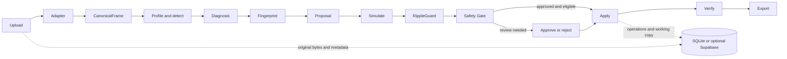

# DataFix architecture

The maintained architecture and safety-policy description is in [`docs/ARCHITECTURE.md`](docs/ARCHITECTURE.md). This root-level entrypoint is provided for repository readers and automated tooling.

## Request and data flow

1. FastAPI validates the multipart request and enforces configured upload limits.
2. `backend/app/ingestion/` selects a CSV or XLSX adapter. The parser returns a canonical Pandas frame plus format metadata. CSV structural mismatches are preserved in metadata columns for review.
3. `backend/app/services.py` profiles the frame, detects issues, attaches evidence, and creates typed proposals and deterministic diagnosis. Shared safe input exceptions live in `backend/app/errors.py`.
4. `backend/app/fingerprints.py` fingerprints observed issue patterns.
5. `backend/app/lifecycle.py` simulates allow-listed operations on copies, calculates impact, checks invariants, applies approved changes atomically, and supports replay/quality verification.
6. `backend/app/main.py` coordinates routes and storage, performs request validation and returns Pydantic response models. It also builds the uncertainty response and Trust Passport from stored run state.
7. `backend/app/storage.py` provides local SQLite persistence and an optional Supabase adapter. CSV/XLSX exporters preserve format-specific behavior through adapter methods.
8. `docs/openapi.json` is generated from the running FastAPI app; `frontend/src/api/generated.ts` is generated from that file.

## Module responsibilities

| Module | Responsibility |
|---|---|
| `backend/app/main.py` | HTTP endpoints, request orchestration, consistent error envelopes, exports, passport and uncertainty endpoints |
| `backend/app/errors.py` | Shared expected input/ingestion exception type |
| `backend/app/schemas.py` | Strict Pydantic request/response and operation parameter models |
| `backend/app/ingestion/` | Format adapters, canonical data conversion, workbook worksheet discovery |
| `backend/app/services.py` | Deterministic profiling, issue detectors, diagnoses and proposal generation |
| `backend/app/fingerprints.py` | Stable issue-pattern fingerprints |
| `backend/app/lifecycle.py` | Simulation, impact metrics, Safety Gate, atomic apply, replay and quality measures |
| `backend/app/storage.py` | Local SQLite and optional Supabase persistence adapters |
| `backend/tests/` | Unit/API/lifecycle regression tests and deterministic fixtures |

`main.py` remains an orchestration module with several endpoints and helper functions; it is not yet split into per-resource routers. `services.py` and `lifecycle.py` are also larger modules and are candidates for incremental extraction after behavior-preserving tests are in place. The active implementation uses SQLite by default. Supabase lifecycle persistence is not currently verified against the supplied remote project.

## Trust boundaries

- Original upload bytes and their hash are stored separately from the mutable working representation.
- Only enumerated repair operations with typed parameters can be simulated or applied. No generated Python/SQL/repair code is executed.
- Human approvals are recorded as decisions; a refused proposal cannot be edited to bypass the gate.
- Optional LLM explanations are not authoritative repair values or decisions; deterministic analysis runs with `LLM_ENABLED=false`.
- Run IDs are identifiers, not authentication. Current API routes lack authentication and tenant isolation and must not be exposed publicly for multiple users as-is.
