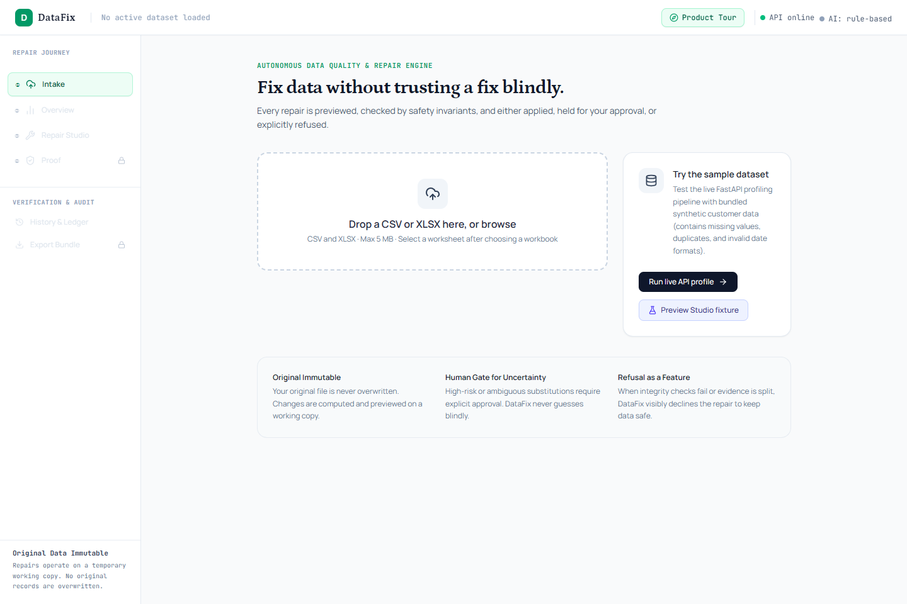
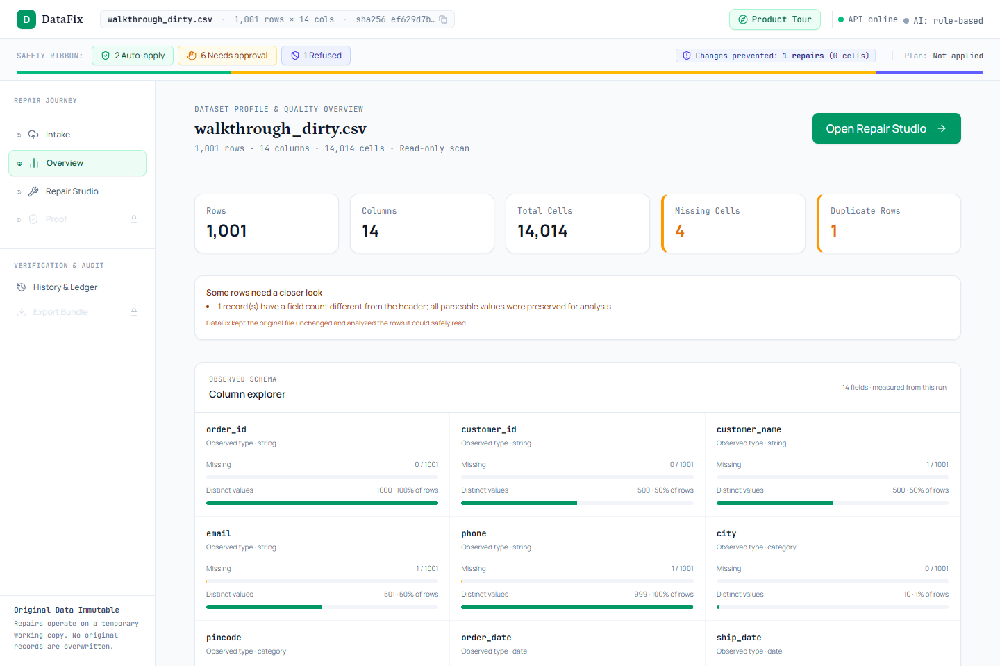
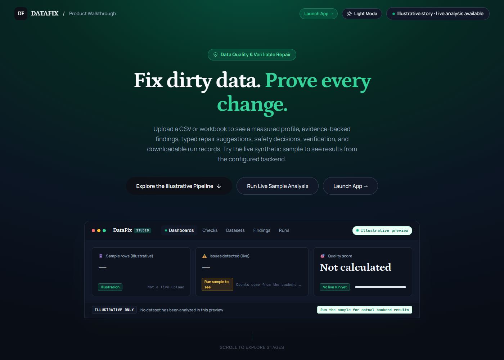
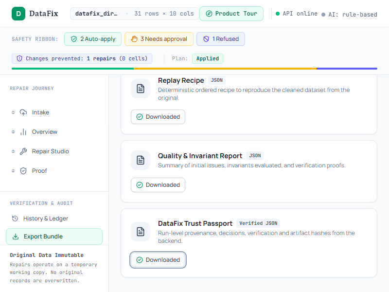

<div align="center">

# DataFix

### From messy data to trustworthy data—with every repair explained, reviewed, and replay-checked.

DataFix is a data-quality workbench for inspecting CSV and Excel data, understanding detected issues, and applying **typed, evidence-backed repairs** through a controlled workflow. Traditional cleanup scripts can silently overwrite useful information; DataFix preserves the original upload, previews proposed changes, applies only eligible repairs, and records what happened.

<p>
  
  
  
  
  
  
</p>

[Quick start](#quick-start) · [Features](#feature-status) · [Architecture](#how-it-works) · [API](#api-at-a-glance) · [Testing](#testing-and-evidence) · [Limitations](#roadmap-and-limitations)

</div>

---

## Why DataFix

Missing values, duplicate rows, inconsistent categories, malformed records, invalid formats, anomalies, and broken relationships make analysis unreliable. A conventional cleanup script may turn these symptoms into data loss: a blank may have no safe replacement, an outlier may be legitimate, and two similar labels may refer to different entities.

DataFix treats repair as a decision that needs evidence. It profiles the uploaded data, shows which records support each finding, proposes only allow-listed operations, simulates their effects, and either applies a repair, asks for human review, or refuses it. The source bytes remain preserved separately from the working copy so that the change history can be checked later.

> **Safety principle:** an outlier is not automatically an error, and a missing value is not automatically safe to impute.

## Product showcase

These are saved screenshots from local Edge browser runs of the DataFix application. Analysis screenshots use **synthetic fixtures**; they are not hosted-service screenshots or customer data. The walkthrough preview is explicitly illustrative. The current intake captures show the 5 MB limit from this repository snapshot.

| Intake — current 5 MB upload limit | Live synthetic analysis — 1,001 rows × 14 columns |
|---|---|
|  |  |

| Product walkthrough — illustrative preview | Export bundle — saved local browser capture |
|---|---|
|  |  |

The current mobile intake capture is available at [`mobile-intake-current.png`](frontend/test-evidence/screenshots/mobile-intake-current.png). The saved export screenshot is from a prior local browser run; it is presented as interface evidence, not a current hosted session.

The repository does not currently include separate screenshots of the issue-detail dossier, individual RippleGuard simulation, uncertainty heatmap, relationship panel, detailed Trust Passport contents, or final verification view. The export screenshot shows the Passport download option, not the full Passport contents. The corresponding feature statuses below distinguish tested backend behavior from partial UI evidence.

## The workflow

```text
Detect → Diagnose → Propose → Simulate → Gate → Apply → Verify → Explain → Track
```

1. **Detect** — Profile the dataset and find deterministic quality issues with affected rows and supporting evidence.
2. **Diagnose** — Present possible explanations tied to the measured evidence. These are hypotheses, not guaranteed root causes.
3. **Propose** — Create typed, allow-listed repair operations. If the engine cannot justify a sufficiently safe change, it leaves the issue unresolved or refuses the proposal.
4. **Simulate** — Apply the proposed operation to a copy and calculate cell diffs, impact metrics, and invariant results.
5. **Gate** — Automatically allow eligible low-risk operations, require an explicit human decision where policy requires it, or refuse a failed invariant.
6. **Apply** — Stage eligible approved changes and persist the batch atomically.
7. **Verify** — Re-analyze the working copy and replay recorded operations from the original parsed data; compare hashes and report remaining/new/resolved issues.
8. **Explain** — Show the evidence, possible cause, proposed action, impact, and decision state. Optional Groq explanations are disabled by default and cannot supply repair values or gate decisions.
9. **Track** — Keep decisions and operation history, and generate export artifacts and a run-level Trust Passport.

DataFix is more than a null-removal or duplicate-removal script: repair operations are explicit, previewed, constrained, reviewable, and traceable.

## Feature status

Status labels reflect the implementation and test evidence recorded in [`docs/FINAL_IMPLEMENTATION_STATUS.md`](docs/FINAL_IMPLEMENTATION_STATUS.md) and [`ADVANCED_FEATURES_STATUS.md`](ADVANCED_FEATURES_STATUS.md). “Implemented and tested” describes the verified local scope; it is not a guarantee for every possible dataset.

| Capability | Status | What the current implementation supports |
|---|---|---|
| Data profiling and quality detection | **Implemented and tested** | Row/column profile, missing/placeholders, exact duplicates, invalid formats, category inconsistencies, supported anomalies, CSV structural row-width mismatches, and selected cross-column rules. Findings include row references and evidence. |
| Diagnosis and explainable proposals | **Implemented and tested** | Deterministic possible-cause hypotheses and typed repair proposals linked to issues. Explanations do not claim a certain root cause. |
| Safe automatic repair | **Implemented and tested** | Eligible operations may be auto-applied by deterministic policy; other proposals require approval or are refused. There is no unrestricted repair-code execution. |
| Human review and manual revisions | **Implemented and tested** | Approve/reject eligible proposals. Manual edits create a versioned proposal and trigger a fresh simulation and gate evaluation before reapproval. |
| RippleGuard — repair impact | **Implemented and tested** | Simulation measures direct changes and supported invariant/relationship impacts. It does not infer arbitrary dependencies. |
| Error Pattern Fingerprinting | **Implemented and tested** | Deterministic patterns are attached to detected issues; fingerprints do not transfer approval between runs. |
| Uncertainty Heatmap | **Implemented and tested** | API response uses actual issues/evidence and decision state; unsupported confidence remains null. |
| Trust Passport | **Implemented and tested** | Built from the run, operations, decisions, verification and artifact hashes. It is an integrity record, not a cryptographic signature. |
| Modification history and undo | **Implemented and tested** | Stored operation ledger and last-active-operation undo; replay/verification is separate from the ledger view. |
| CSV ingestion and export | **Implemented and tested** | Encoding/delimiter detection, bounded upload and structural-row recovery. Original bytes are retained; cleaned CSV is exported separately. |
| Excel ingestion/export | **Implemented and tested, with limits** | `.xlsx` worksheet discovery/selection and shared pipeline. Unsafe structural changes and formula-cell overwrites are refused. Not every Excel extension or embedded object is certified for round-trip preservation. |
| Smart Schema Discovery | **Partial** | Type, missingness, and uniqueness profiling exists; complete semantic-role inference and user confirmation are not established. |
| Relationship Guardian | **Partial** | A limited set of explicit within-dataset rules is checked. General foreign-key/orphan discovery, multi-table joins, and a verified interactive relationship graph are not implemented. |
| Context-aware anomaly detection | **Partial** | Deterministic statistical checks and supported rules exist; broad domain-configurable context is not implemented. Outliers are flagged, not automatically corrected. |
| Repair Recipe | **Export only** | Recipe JSON export exists. Import/reuse on another dataset with compatibility review and fresh simulation is not implemented. |
| JSON / JSONL / Parquet ingestion | **Not implemented** | The upload adapter currently supports CSV and `.xlsx` only. |
| Supabase lifecycle persistence | **Blocked / unverified live** | Adapter and mocked tests exist. Prior live evidence returned `404/PGRST205` for missing schema; a complete remote lifecycle and restart-persistence test has not passed. |
| Groq explanations | **Optional; current access unverified** | Disabled by default; deterministic fallback is available. Current account/model access is not claimed as live. |

## How it works

```mermaid
flowchart LR
    U[User selects CSV or XLSX] --> FE[React + TypeScript workbench]
    FE -->|OpenAPI-defined HTTP requests| API[FastAPI + Pydantic API]
    API --> VAL[Upload bounds and file validation]
    VAL --> AD[CSV or XLSX adapter]
    AD --> CD[Canonical tabular representation]
    CD --> PD[Profile and deterministic detectors]
    PD --> DX[Evidence, diagnosis hypotheses, fingerprints]
    DX --> RP[Typed repair proposals]
    RP --> SIM[Simulation and RippleGuard impact]
    SIM --> SG[Invariant checks and Safety Gate]
    SG -->|eligible| AUTO[Auto-apply lane]
    SG -->|review required| HUMAN[Human approve or reject]
    SG -->|invariant failure| REFUSE[Refused / unresolved]
    AUTO --> APPLY[Atomic apply to working copy]
    HUMAN --> APPLY
    APPLY --> VERIFY[Re-analysis, replay and hash comparison]
    VERIFY --> PASSPORT[Trust Passport and reports]
    PASSPORT --> OUT[CSV/XLSX and JSON downloads]
    API <--> STORE[(Local SQLite by default)]
    API -. optional, not live-verified .-> SB[(Supabase Postgres + private Storage)]
    PD -. optional explanations only; disabled by default .-> GROQ[Groq API]
```



### Technology stack

| Technology | Declared version / range | Responsibility |
|---|---|---|
| Python | `>=3.11` | Backend runtime. |
| FastAPI | `>=0.115,<1` | HTTP API, request validation and OpenAPI generation. |
| Pydantic | `>=2.8` | Strict request/response models and typed repair parameters. |
| Pandas / NumPy | `pandas>=2.2`, `numpy>=1.26` | Canonical tabular data, profiling and deterministic statistical checks. |
| SQLite | Python standard library | Default local persistence for runs, working data, decisions, operations, verification and artifacts. |
| openpyxl | `>=3.1,<4` | XLSX worksheet inspection and format-aware export. |
| Supabase | HTTP/PostgREST + Storage adapter; no JS client required for API workflow | Optional remote persistence. Not a verified live deployment. |
| Groq | Python standard-library HTTP client | Optional constrained explanation call; no request when disabled/missing credentials; not currently verified live. |
| React / React DOM | `^19.3.1` | Frontend UI. |
| TypeScript | `^5.9.0` | Frontend type checking and API client types. |
| Vite | `^8.3.8` | Frontend dev server and production build. |
| Tailwind CSS | `^4.3.5` | Utility styling. |
| OpenAPI TypeScript | `^7.13.0` | Generates client declarations from `docs/openapi.json`. |

The project is a modular monolith, not a deployed microservice system. The backend selects local SQLite by default. Supabase is an optional adapter awaiting schema provisioning and a successful live lifecycle test. Deployment files prepare a Vercel frontend and Render API, but no hosted service URL is available yet.

## Safety and data integrity

- **Original preservation:** uploaded bytes and their SHA-256 are stored separately from the working dataset. Repairs do not overwrite the source upload.
- **Typed operations:** proposals use enumerated operation types and validated parameters. The backend does not execute repair code generated by an LLM.
- **Preview first:** simulation evaluates a proposed operation against a copy and reports affected cells/rows, impact, and invariant results.
- **Explicit decisions:** eligible operations can be automatic; higher-risk or ambiguous work can require approval. A refused proposal cannot be approved to bypass a failed gate.
- **Atomic batch apply:** the selected apply plan is staged and checked before persistence. Failed combined invariants abort the batch.
- **Replay verification:** verification replays recorded operations and compares the replayed result with the active working dataset. Hash equality and issue counts are reported.
- **Traceability:** decisions, operation history, exports, and the Trust Passport are derived from stored run state.
- **Measured risk policy:** aggregate-drift ceilings are deterministic policy settings, not learned confidence scores or proof of semantic correctness.

## Quick start

### Prerequisites

- Python 3.11 or newer.
- Node.js/npm versions compatible with the checked-in `frontend/package-lock.json`.
- Windows PowerShell, macOS, or Linux shell.
- No Supabase or Groq credentials are required for local deterministic analysis.

### Clone

```bash
git clone https://github.com/Anik-da/Datafix.git
cd Datafix
```

### Windows PowerShell

In terminal 1, start the backend:

```powershell
cd backend
python -m venv .venv
.\.venv\Scripts\Activate.ps1
python -m pip install -e ".[test,quality]"
Copy-Item .env.example .env
# Keep LLM_ENABLED=false for deterministic, credential-free local use.
python -m uvicorn app.main:app --host 127.0.0.1 --port 8000
```

In terminal 2, start the frontend from the repository root:

```powershell
cd frontend
npm ci
Copy-Item .env.example .env
npm run dev
```

Open `http://127.0.0.1:5173`. The API and interactive OpenAPI docs are at `http://127.0.0.1:8000` and `http://127.0.0.1:8000/docs`.

### macOS / Linux

Backend terminal:

```bash
cd backend
python3 -m venv .venv
source .venv/bin/activate
python -m pip install -e '.[test,quality]'
cp .env.example .env
LLM_ENABLED=false python -m uvicorn app.main:app --host 127.0.0.1 --port 8000
```

Frontend terminal:

```bash
cd frontend
npm ci
cp .env.example .env
npm run dev
```

Set `VITE_API_BASE_URL` in `frontend/.env` only if the backend origin differs from the local default. The API CORS origins are configured by `DATAFIX_CORS_ORIGINS` in `backend/.env`.

### Supabase (optional; not live-verified)

Local SQLite is the default and recommended for first run. To configure Supabase, first create/provision the project schema from [`backend/docs/supabase_schema.sql`](backend/docs/supabase_schema.sql) and create the private Storage bucket named by `SUPABASE_STORAGE_BUCKET` (default `datafix`). Then configure `SUPABASE_URL`, a **rotated backend-only** `SUPABASE_SECRET_KEY` (or supported legacy `SUPABASE_SERVICE_ROLE_KEY`), and `DATAFIX_STORAGE_BACKEND=supabase` in the backend environment only. Never place a secret/service-role key in frontend variables or commit it.

The remote project has not passed a complete upload-to-export lifecycle and restart-persistence test; prior evidence recorded `404/PGRST205` for missing schema. Do not treat connection checks or mocked tests as live storage acceptance. Full guidance: [`docs/SUPABASE_SETUP.md`](docs/SUPABASE_SETUP.md).

### Optional Groq

Groq is not required for analysis. The `.env.example` default is `LLM_ENABLED=false`. If deliberately enabling it, set `GROQ_API_KEY` and an account-supported `LLM_MODEL` in the backend environment. The LLM may only select among supplied diagnosis hypotheses and return a short explanation; deterministic detectors, repair values, confidence, and gate decisions remain backend-controlled. Current live model access is unverified; see [`docs/LIMITATIONS.md`](docs/LIMITATIONS.md).

## API at a glance

The Pydantic schemas and [`docs/openapi.json`](docs/openapi.json) are the source of truth. Frontend types are generated at [`frontend/src/api/generated.ts`](frontend/src/api/generated.ts). Swagger UI runs at `/docs`.

| Method | Path | Purpose |
|---|---|---|
| `GET` | `/health` | Local API health/config summary. |
| `POST` | `/api/v1/runs` | Upload CSV/XLSX as multipart field `file`; optional `worksheet` selects an Excel sheet. |
| `POST` | `/api/v1/datasets/worksheets` | List worksheet names for an XLSX upload. |
| `POST` | `/api/v1/runs/{run_id}/analyze` | Profile and analyze an uploaded run. |
| `POST` | `/api/v1/runs/{run_id}/proposals/{proposal_id}/edit` | Revise a proposal, resimulate, and re-evaluate the gate. |
| `POST` | `/api/v1/runs/{run_id}/decisions` | Approve/reject eligible proposals. |
| `POST` | `/api/v1/runs/{run_id}/apply` | Apply eligible operations atomically. |
| `GET` | `/api/v1/runs/{run_id}/operations` | Retrieve operation history. |
| `POST` | `/api/v1/runs/{run_id}/verify` | Re-analyze and verify deterministic replay. |
| `POST` | `/api/v1/runs/{run_id}/undo/{op_id}` | Attempt last-operation undo. |
| `GET` | `/api/v1/runs/{run_id}/uncertainty` | Read analysis/decision-derived uncertainty records. |
| `GET` | `/api/v1/runs/{run_id}/export/passport` | Download the Trust Passport JSON. |
| `GET` | `/api/v1/runs/{run_id}/export/{artifact}` | Download `cleaned`, `report`, `log`, `recipe`, or `passport`. |

The compatibility profile route is `POST /api/v1/datasets/profile`. Exact schemas, status codes, and error envelopes are in OpenAPI; this README intentionally does not redefine them.

### Upload and analyze example

Run from the repository root. The sample is synthetic and has a matching manifest under `samples/`.

```bash
curl -sS -F "file=@samples/walkthrough_dirty.csv" \
  http://127.0.0.1:8000/api/v1/runs
```

The upload response contains `run.id`, the original `file_sha256`, file size, row/column counts, status, creation time, format metadata, and any structural warnings. Use the returned run ID:

```bash
curl -sS -X POST \
  http://127.0.0.1:8000/api/v1/runs/<run-id>/analyze
```

Analysis returns `run`, `profile`, `issues`, `proposals`, and `summary`. Each issue includes evidence and affected row references; each proposal has an operation, typed params, simulation, gate and status as defined by the response model.

### Review, apply, verify, history, export

For approval-required proposals, use the exact proposal ID and action from the analysis response. Example request shape:

```json
{
  "decisions": [
    { "proposal_id": "<proposal-id>", "action": "approve" }
  ]
}
```

Send it to `POST /api/v1/runs/<run-id>/decisions`. Only proposals whose current gate requires approval are eligible; a refused proposal cannot be overridden. Then:

```bash
curl -sS -X POST http://127.0.0.1:8000/api/v1/runs/<run-id>/apply
curl -sS -X POST http://127.0.0.1:8000/api/v1/runs/<run-id>/verify
curl -sS http://127.0.0.1:8000/api/v1/runs/<run-id>/operations
curl -OJ http://127.0.0.1:8000/api/v1/runs/<run-id>/export/cleaned
curl -OJ http://127.0.0.1:8000/api/v1/runs/<run-id>/export/report
curl -OJ http://127.0.0.1:8000/api/v1/runs/<run-id>/export/passport
```

An excerpt from the saved local synthetic verification response (`test-evidence/live_walkthrough/verification.json`) is shown below; it is not a complete response object:

```json
{
  "replay": {
    "operations": 2,
    "input_hash": "<sha256>",
    "replay_hash": "<sha256>",
    "match": true
  },
  "issues": {
    "before": 18,
    "after": 15,
    "resolved": 3,
    "introduced": 0
  },
  "valid_cells_damaged": 0
}
```

Error responses use the shared `ErrorEnvelope`. Upload size defaults to 5 MiB in backend configuration; row, column, cell, and CORS limits are environment-controlled.

## Testing and evidence

From `backend/`:

```bash
python -m pip install -e '.[test,quality]'
LLM_ENABLED=false python -m pytest -q
ruff check app tests
ruff format --check app tests
python generate_openapi.py
```

From `frontend/`:

```bash
npm ci
npm run build
npm audit
npm exec -- openapi-typescript ../docs/openapi.json --output src/api/generated.ts
```

The backend suite contains detector, API, lifecycle, gate, data-integrity, verification, undo/reapply, export, XLSX, mocked Supabase/Groq, and advanced-feature regression cases. Synthetic ground-truth fixtures and manifests are in `backend/tests/fixtures/`; benchmark samples and manifests are in `samples/`. Tests use local storage/mocks and do not constitute live Groq or Supabase proof.

**Latest recorded result for this repository snapshot:** 48 backend tests passed with `LLM_ENABLED=false` (one Starlette/httpx deprecation warning); Ruff checks passed; TypeScript/Vite production build passed; `npm audit` reported 0 vulnerabilities. MyPy reports unresolved errors and is **not** claimed as passing. See [`CODE_QUALITY_AUDIT.md`](CODE_QUALITY_AUDIT.md), [`frontend/test-evidence/BROWSER_TEST_RESULTS.md`](frontend/test-evidence/BROWSER_TEST_RESULTS.md), and [`test-evidence/WALKTHROUGH_END_TO_END_TEST.md`](test-evidence/WALKTHROUGH_END_TO_END_TEST.md) for scope and caveats.

Recorded browser evidence covers local synthetic upload/analysis, manual proposal revision and approval, apply, verification, history, and downloads. It does not cover every chart, screen-reader behavior, all failure states, or every workflow action through the graphical interface.

## Deployment

The intended topology is **Vercel for the static frontend → Render for FastAPI → Supabase Postgres/Storage as optional persistent storage**. It is a deployment plan, not a current public deployment: there is no Render/Vercel service URL to provide, and Supabase lifecycle persistence is not yet verified.

Recommended order:

1. Provision the Supabase schema and private bucket, then pass a real persistence-after-restart lifecycle test—or deliberately select another supported persistent backend before public deployment.
2. Deploy the backend to Render and set `SUPABASE_URL`, backend-only `SUPABASE_SECRET_KEY`, `SUPABASE_STORAGE_BUCKET`, `DATAFIX_STORAGE_BACKEND`, and exact `DATAFIX_CORS_ORIGINS` as server environment/secrets. `LLM_ENABLED` can remain `false`.
3. Confirm Render `/health` and the deployed CORS preflight using the exact frontend origin.
4. Deploy `frontend/` to Vercel and set `VITE_API_BASE_URL` to the actual Render service URL. No URL is invented here.
5. Run API acceptance checks against the deployed service before directing users to it.

The API currently has no authentication or tenant isolation. Do **not** expose it as a public multi-user service until access control, persistent storage, and deployment behavior have been designed and tested. See [`docs/DEPLOYMENT_VERCEL.md`](docs/DEPLOYMENT_VERCEL.md), [`docs/DEPLOYMENT_RENDER.md`](docs/DEPLOYMENT_RENDER.md), and [`docs/SUPABASE_SETUP.md`](docs/SUPABASE_SETUP.md).

## Roadmap and known limits

| Status | Work |
|---|---|
| **Implemented and tested locally** | CSV and XLSX shared pipeline; deterministic profiling/detection; typed proposals; simulation, RippleGuard and gate; review, apply, replay verification, history and exports; tested fingerprint, uncertainty, manual-edit and Trust Passport paths. |
| **In progress / partial** | Broader schema semantics, user-configurable relationship constraints, generalized contextual anomaly rules, full interactive visual evidence, and static type cleanup. |
| **Planned** | JSON/JSONL/Parquet adapters and repair recipe import/reuse, after format-preservation and compatibility requirements are tested. |
| **Blocked / unverified** | Live Supabase lifecycle until schema/bucket provisioning and authenticated restart testing; current Groq model access; hosted Vercel/Render deployment. |

Additional limits: calibrated confidence is not implemented; statistical anomalies are not automatically repaired; XLSX round-trip fidelity for every workbook extension is not certified; the detector benchmark uses synthetic data and is not a general accuracy guarantee. Current type checking reports unresolved MyPy errors. Details: [`docs/LIMITATIONS.md`](docs/LIMITATIONS.md) and [`CODE_QUALITY_AUDIT.md`](CODE_QUALITY_AUDIT.md).

## Contributing

Start with [`CONTRIBUTING.md`](CONTRIBUTING.md) and [`TESTING.md`](TESTING.md). Keep format-specific parsing/export in adapters, share the canonical analysis and repair pipeline, add regression tests for behavior changes, regenerate OpenAPI-derived types after contract changes, and never commit `.env` files, credentials, or private datasets. The checked-in `.gitignore` excludes local secrets and runtime data.

## License and project information

There is currently no `LICENSE` file in this repository. Until a license is added, no repository-specific reuse permissions are granted. No external contact address or support channel is published in this project.

---

<div align="center">

**DataFix makes repair reviewable. It does not ask you to trust a change you cannot inspect.**

</div>
