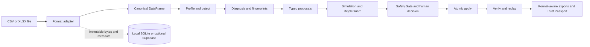

# DataFix

DataFix is a local-first data-quality workbench. It profiles tabular files, finds deterministic data-quality issues with row-level evidence, proposes typed repairs, previews their impact, and applies only proposals that pass invariant checks and the review policy.

## What it does

- Ingests CSV and `.xlsx` files; XLSX supports choosing a worksheet. JSON ingestion is not implemented.
- Preserves original upload bytes and a SHA-256 independently from the working copy.
- Profiles columns and detects missing/placeholders, duplicates, invalid formats, inconsistent categories, anomalies, structural CSV row mismatches, and supported cross-column rules.
- Produces typed repair proposals. Simulations measure affected cells, schema/row/key changes, valid-cell changes, supported relationship/business-rule effects, and numeric aggregate drift. A deterministic Safety Gate can refuse unsafe work or require human approval.
- Records approval/rejection, applies eligible operations atomically, verifies replay, supports last-operation undo, and exports cleaned data and run reports.
- Provides RippleGuard impact analysis, issue fingerprints, decision-aware uncertainty, manual proposal revisions, and a Trust Passport derived from run records.

The analysis engine is deterministic and works without credentials. Optional Groq explanations are disabled by default. Supabase is an optional storage adapter, but the configured remote project has not passed schema provisioning and a full lifecycle persistence test. Do not treat the adapter or a mocked test as live integration proof.

## Architecture



The API orchestrates application state; format-specific parsing/export is behind adapter boundaries; profiling/detection and lifecycle operations are separated into backend modules. See [docs/ARCHITECTURE.md](docs/ARCHITECTURE.md) and [architecture entrypoint](ARCHITECTURE.md).

## Technology

- Backend: Python 3.11+, FastAPI, Pydantic 2, Pandas, NumPy, SQLite; optional Supabase REST/Storage and constrained Groq explanations.
- Frontend: React, TypeScript, Vite, Tailwind CSS. It consumes OpenAPI-derived types from `frontend/src/api/generated.ts` and does not require a Supabase browser client for the DataFix API.
- API contract: `docs/openapi.json` is the generated OpenAPI source of truth.

## Run locally on Windows PowerShell

Open two terminals from the repository root.

Backend terminal:

```powershell
cd backend
python -m venv .venv
.\.venv\Scripts\Activate.ps1
python -m pip install -e ".[test,quality]"
Copy-Item .env.example .env
python -m uvicorn app.main:app --host 127.0.0.1 --port 8000
```

Frontend terminal:

```powershell
cd frontend
npm ci
Copy-Item .env.example .env
npm run dev
```

Open `http://127.0.0.1:5173`. Swagger is at `http://127.0.0.1:8000/docs`; health is at `http://127.0.0.1:8000/health`. Set `VITE_API_BASE_URL` in `frontend/.env` only when the API origin differs from the default. The local deterministic workflow does not need external API keys.

## How the safety policy works

Proposals contain explicit allow-listed operations and validated typed parameters. Preview applies a proposal on a copy and reports measured changes and invariant checks. The gate refuses failed checks and requires an explicit decision for higher-risk proposals. Apply stages the selected batch and persists it only after the batch passes checks. LLM output cannot create operations, values, code, or gate decisions. This is a deterministic risk policy, not a formal proof that a repair is correct.

## Tests and quality checks

From `backend/`:

```powershell
python -m pytest -q
ruff check app tests
ruff format --check app tests
python -m mypy app --ignore-missing-imports --show-error-codes
python generate_openapi.py
```

From `frontend/`:

```powershell
npm ci
npm run build
npm audit
```

See [TESTING.md](TESTING.md), [API_DOCUMENTATION.md](API_DOCUMENTATION.md), and the measured limitations in [CODE_QUALITY_AUDIT.md](CODE_QUALITY_AUDIT.md). Type checking currently reports unresolved errors and is explicitly not claimed as passing.

## Optional Supabase configuration

Local SQLite is the supported default. Supabase uses a backend-only secret and provisioned SQL schema/private Storage bucket. Rotate any key that was exposed in chat, provision the schema, and pass a full upload-to-export/restart persistence test before relying on it. See [docs/SUPABASE_SETUP.md](docs/SUPABASE_SETUP.md) and [backend/ENVIRONMENT.md](backend/ENVIRONMENT.md). Never put a Supabase secret/service-role key in `frontend/.env` or commit it.

## Deployment status

Vercel and Render preparation files exist, but no hosted deployment or public live URL has been created or verified. Follow [docs/DEPLOYMENT_VERCEL.md](docs/DEPLOYMENT_VERCEL.md) and [docs/DEPLOYMENT_RENDER.md](docs/DEPLOYMENT_RENDER.md) only after the API, CORS origins, persistent storage, and authentication requirements are addressed. Current API run routes do not provide user authentication or tenant isolation; do not expose them as a public multi-user service without adding and testing an access-control design.

## Sample data and known limitations

Synthetic fixtures and manifests are under `backend/tests/fixtures/` and `samples/`. The fixtures are for repeatable tests, not representative proof for arbitrary business datasets. JSON ingestion and recipe import/reuse are not implemented; some advanced schema/relationship/anomaly capabilities are partial. XLSX round-tripping cannot guarantee preservation of every Excel extension or embedded object. Read [docs/FINAL_IMPLEMENTATION_STATUS.md](docs/FINAL_IMPLEMENTATION_STATUS.md) and [docs/LIMITATIONS.md](docs/LIMITATIONS.md) before making feature claims.
